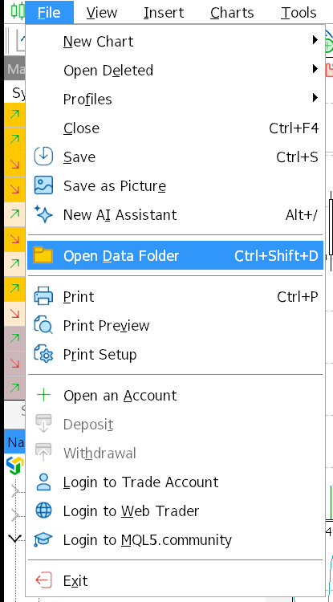
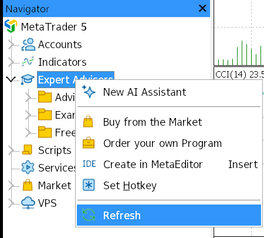
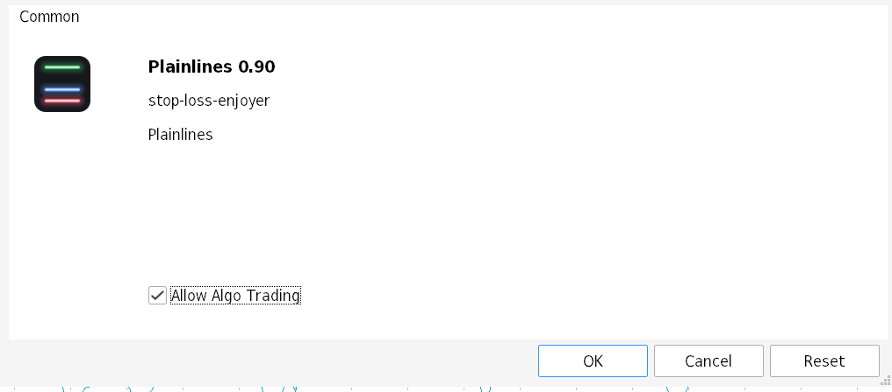
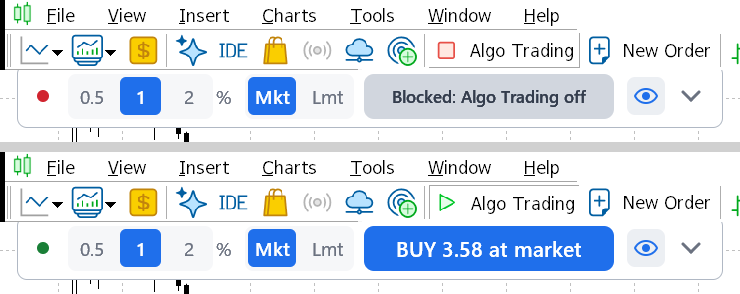
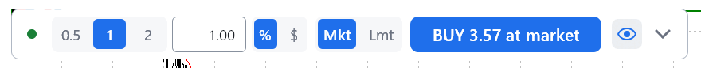

# Install Plainlines

Five steps, a minute or two. Nothing to configure afterwards.


A 34 second video of the install and the first trade, with sound, is attached to every release as `plainlines-promo.mp4`.

## Before you start

You need the file `Plainlines.ex5`. Download it from [Releases](../../releases). The release has three files:

- `Plainlines.ex5`, the program, the only file you need;
- `SHA256SUMS`, its checksum, so you can check that the file is the one that was published (see "Check the file" below);
- `plainlines-promo.mp4`, the video.

The steps are the same on Windows, macOS and Linux: everything happens inside MetaTrader 5. On macOS the official MetaTrader 5 app runs in its own built-in Wine, and File, Open Data Folder opens the right folder in Finder. Plainlines has been tested on demo accounts, on Linux under Wine; Windows and macOS have not been tried yet, see [COMPATIBILITY.md](COMPATIBILITY.md).

If you build Plainlines yourself (see "Build from source" in MANUAL.md), the file lands in `MQL5/Experts/Plainlines/`, not in `MQL5/Experts`, and a plain build trades only on a demo account. Keep only one copy of Plainlines, or the Navigator shows two.

### Check the file

Put `Plainlines.ex5` and `SHA256SUMS` in one folder and run one command there:

- Windows (Command Prompt): `certutil -hashfile Plainlines.ex5 SHA256`, then compare the line it prints with the one in `SHA256SUMS`.
- Linux: `sha256sum -c SHA256SUMS`, which should print `Plainlines.ex5: OK`.
- macOS (Terminal): `shasum -a 256 -c SHA256SUMS`, which should print `Plainlines.ex5: OK`.

The checksum only shows that you got the file that was published. It does not show what the file was built from; for that, build your own (see SECURITY.md).

## 1. Open the data folder

In MetaTrader 5 choose File, then Open Data Folder (Ctrl+Shift+D does the same).



## 2. Put the file in MQL5/Experts

In the folder that opens, go into `MQL5`, then `Experts`, and put `Plainlines.ex5` there. The path ends like this:

```
MQL5/Experts/Plainlines.ex5
```

The `Experts` folder may already hold folders of the terminal's own examples (Advisors, Examples, Free Robots). Leave them alone and put the file straight into `Experts`.

## 3. Refresh the Navigator

In the Navigator panel (View, Navigator, if it is closed) right click Expert Advisors and choose Refresh. Plainlines appears under Expert Advisors, at the end of the list. If you do not see it, the list may be longer than the Navigator window: collapse Accounts or scroll the list. If it is still not there, restart the terminal.



## 4. Drag it onto a chart

Drag Plainlines from the Navigator onto a chart. In the window that opens, under Common, tick Allow Algo Trading (if it is not ticked already) and press OK. You do not need to allow DLL imports. Plainlines has none, so the window has no DLL box.



## 5. Turn on the Algo Trading button

In the terminal toolbar the Algo Trading button must be green (a red square means off). Click it to switch.



When the market of the chart symbol is closed (at the weekend, for example), the button says "Blocked: market closed" before it says anything about Algo Trading. Turn the Algo Trading button on anyway: once the market opens, the panel is ready.

**Read this about step 5.** The Algo Trading button is one switch for the whole terminal. Turning it on lets every expert advisor attached to every chart of this terminal trade, not only Plainlines. Check what else is attached before you turn it on. While the button is off, the panel shows "Blocked: Algo Trading off" on its button and sends nothing.

## Done

A one row panel sits on the chart, with the Entry, SL and TP lines. The dot at its left is green when it is ready. Drag the SL line to where your stop belongs, pick the risk (0.5, 1 or 2 percent, or type it in the field next to them, in percent or in the account currency), and the button shows the side and the lot.



**Set your risk first: after the first trade, one click sends the order at the risk on the panel (1% by default).** The very first trade after install asks for a second press, so you see what goes out (the button reads CONFIRM with the side and the lot, the full panel also shows the risk). After that Confirmation is off by default, so the BUY or SELL button sends the order at once, using the lines as they are. If you want a second press every time, turn on Confirmation in the menu (section Confirm). For a risk other than 0.5, 1 or 2 percent, type the number in the risk field of the strip (the %/currency switch next to it picks the unit) and press Enter or click anywhere outside the field.

The first trade step by step is in the [README](README.md#your-first-trade).

Trade sounds are on by default (one soft key press on open and on close). The switch is in the menu, in Look, Sounds.

## Close a trade

1. Press the small arrow at the right end of the strip to open the full panel.
2. At the bottom of the full panel stands the Positions row, for example "1 pos". Click it to open the list. If the panel is cut off by the edge of the chart, scroll it with the mouse wheel.
3. In the list, the x at the end of a row closes that position or deletes that pending order.
4. To close everything of Plainlines, press Close all, then press it again (it reads "Sure? Close all") after half a second and within 3 seconds. The button next to it, Close and the chart symbol (for example Close EURUSD), does the same for the chart symbol. After Close all the status line first says, for example, "Closed 3 of 3, P&L -$12.40", and once the broker reports the deals, one net total, for example "Closed 3 · -$12.40 net".

Close all and the close button of the chart symbol touch only what Plainlines opened.

## After a fill

- **To move the SL of an open position, move it in the terminal.** Drag the level of the position on the chart. The Modify window that may open is MetaTrader's own. The panel picks up the new SL by itself and counts the open risk again.
- **The plan lines hide by themselves.** Right after a trade of the panel, its lines would lie on the levels of the position, and a drag would move the level of the position in MetaTrader instead. So the eye button turns itself off on that symbol and the plan lines are hidden. Press the eye to bring them back for the next trade. If MetaTrader shows its One Click Trading disclaimer after you drag a level of the position, press Cancel: Accept turns on one-click trading for the whole terminal.
- **The button stays live.** The next click sends the next trade, at the risk on the panel.

## What it sets up by itself

- **Broker data.** The account currency, contract size, lot step, tick size and the broker's commission rule are read from the terminal each time the panel counts a lot, so you enter none of it. Some symbols have no commission rule at the broker. For them the panel says "Commission not counted" and the Commission section of the menu lets you type a rate.
- **Memory.** The panel keeps its view (one row or full), its place on the chart, the lines switch, the menu settings and your last risk, and brings them back after a restart. The risk is remembered for each account. Everything is plain text in `MQL5/Files/Plainlines`.

## If something does not work

| What you see | What to do |
|---|---|
| Plainlines is not in the Navigator | Right click Expert Advisors, Refresh. Check that the file is in `MQL5/Experts` and ends with `.ex5`. Restart the terminal if it still is not there. |
| Button says "Blocked: Algo Trading off" (full panel: "Turn on Algo Trading in the terminal toolbar") | Turn on the Algo Trading button in the toolbar (step 5). |
| Button says "Blocked: algo not allowed" (full panel: "Tick Allow Algo Trading (F7 on chart)") | Press F7 on the chart, under Common tick Allow Algo Trading, press OK. |
| Button says "Blocked: other Plainlines" | Plainlines Pro (a planned paid version) stands on another chart of this terminal, and only one of the two trades per terminal. Remove one of them: right click the chart, Expert List (Alt+X), pick it and press Remove. Details in MANUAL.md, "One Plainlines per terminal". |
| Another expert advisor is on the chart | A chart holds one expert advisor at a time. Use a chart without another one, or remove the other one first. The name in the top right corner of the chart tells which one is attached. |
| Shift+T does nothing | Click on the chart first so it has the keyboard focus. Hotkeys do not work while you type in a panel field. The first Shift+T only shows CONFIRM: press it again after half a second and within 3 seconds, and any other key in between cancels. Nothing happens while the button says Blocked. |
| "newer unsupported version" when the file loads | The file was built on a newer terminal than yours. Update MetaTrader 5 and try again. |
| Button says "Blocked: read-only login" ("This login is read-only (investor password)") | You logged in with the investor password. Log in with the trading password. |
| Button says "Blocked: no EAs here" ("The broker does not allow Expert Advisors here") | This account does not allow expert advisors. Ask the broker or use another account. |
| Button says "Blocked: no connection" ("No connection to the server") | Wait until the terminal reconnects, then the panel works again. |
| Button says "Blocked: market closed" ("Market closed, last quote shown") | The market of this symbol is closed. The numbers are from the last quote, and nothing is sent until it opens. |
| Button says "Blocked: no quote" ("No quote for this symbol") | Wait for the first tick. A symbol the broker gives no quotes for cannot be traded, so pick another one. |
| The lines are gone and the prices are only in the panel fields | The eye button in the panel is off (it also turns itself off after a trade of the panel). Click it to bring the lines back. |
| The chart is empty after you switched account | This account has no such symbol, so open a symbol it has. If the panel still does not show, remove Plainlines from the chart (Alt+X, Remove) and drag it on again. |
| The panel is cut off at the bottom | Choose a smaller scale in Look, make the chart taller, or scroll the panel with the mouse wheel. |
| You typed a risk and nothing changed | Press Enter or click outside the field. |
| You drag the Entry line and the MetaTrader Modify window opens | On the price of an open position lies the line of the position itself, and the mouse grabs that one. Drag the Plainlines line a little to the side of it, or turn off the display of trade levels in the terminal (Tools, Options, Charts, Show trade levels). |
| The Entry line will not snap back to Market when you drop it | The Market zone is measured in screen pixels, not in price: about 6 at Scale 100, more at 125 or 150 (with Scale on Auto it follows your Windows scaling), never less than 2 ticks. Drop the line closer to the price, or press Market. |

If none of this helps, open an issue in [Issues](../../issues).

## Remove it

1. Remove Plainlines from the chart: right click the chart, choose Expert List (Alt+X), pick Plainlines and press Remove. Its lines and labels go with it.
2. Delete `Plainlines.ex5` from `MQL5/Experts` (or the folder `MQL5/Experts/Plainlines` if you built it from source).
3. Delete the folder `MQL5/Files/Plainlines`. It holds the settings the panel remembered.

PRIVACY.md lists everything Plainlines stores and where.
