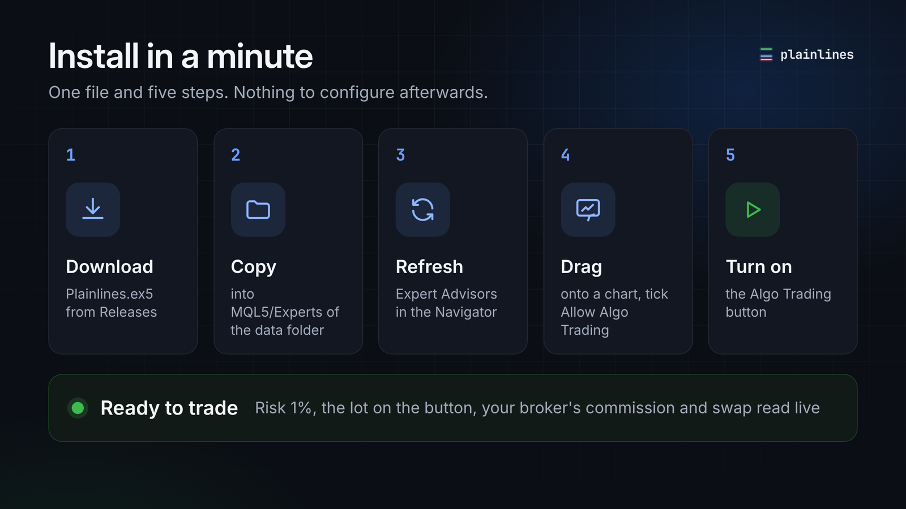
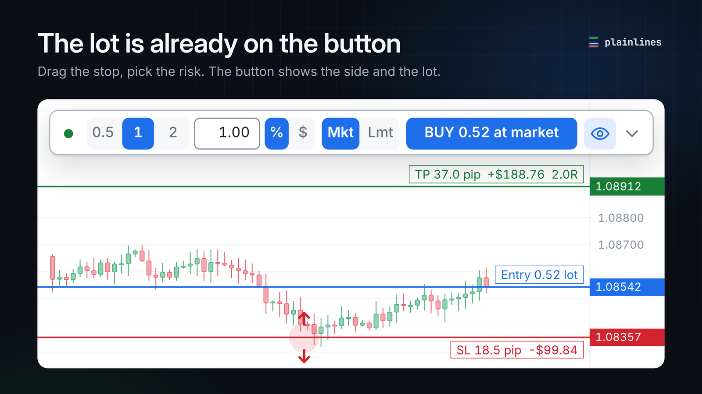
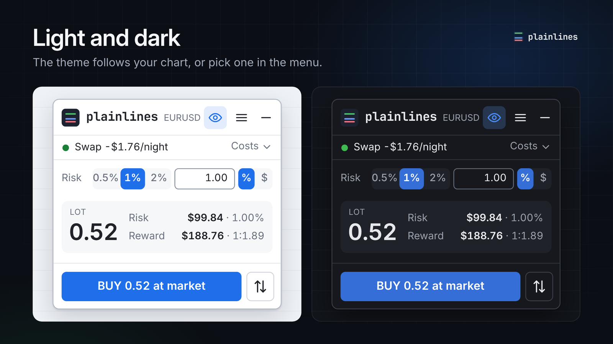
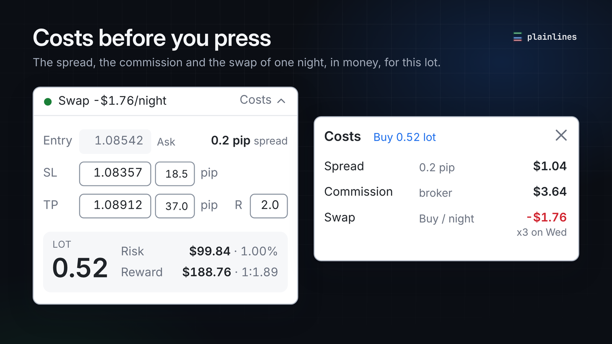
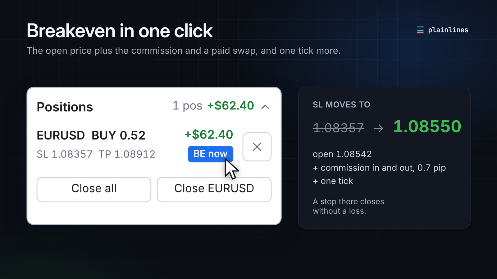
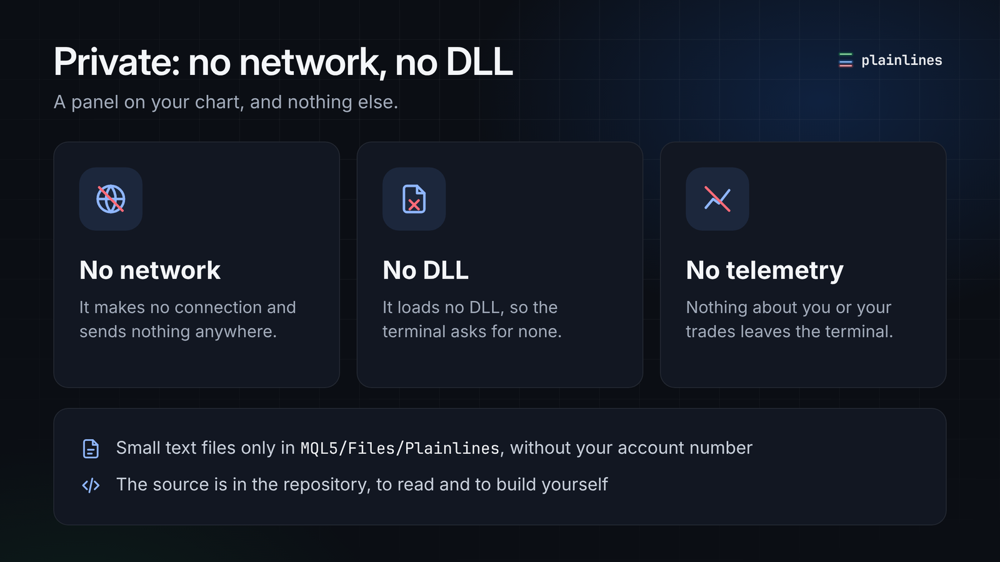

# Plainlines

**Drag the stop. Pick the risk. Press once.** Plainlines is a free trade panel for MetaTrader 5 that turns three lines on your chart into an order with the right lot.

In short: a position size calculator and one-click order panel (an expert advisor) for MT5. You set the stop loss with the mouse and the risk as a percent or a sum of money, and Plainlines works out the lot size, with the spread, the commission and the broker's lot rules counted, then sends the order with its SL and TP. It works for forex, gold and other metals, indices, oil, crypto and share CFDs, on broker and prop firm accounts.

https://github.com/user-attachments/assets/33eb0862-52e2-4045-adbe-e0c19ad5a353

- **Install once, then just trade.** One file, five steps, a minute or two. Risk 1 percent by default, your broker's commission and swap read live from the terminal. Nothing to set up before the first trade.
- **The lot is right, or there is no trade.** Spread, commission and the broker's lot rules go into the lot. When something does not add up, the panel blocks and says why in one line. It never guesses.
- **Private by design.** No network, no DLL, no telemetry, no account number in its files. The source is here to read.

Free for your own trading, prop firm accounts included. Plainlines gives no signals and is not investment advice: you decide every trade.

**Version 0.9.2** (shown as 0.92 in the terminal). Tested on demo accounts and used in live trading on a real broker account (Bybit) and a real prop firm account (FTMO), on Linux under Wine. A first user installed it on Windows 11 without problems; macOS has not been checked yet. What was and was not tried is in [COMPATIBILITY.md](COMPATIBILITY.md).

## Install

1. Download `Plainlines.ex5` from [Releases](../../releases).
2. In MetaTrader 5 choose File, Open Data Folder, and put the file in `MQL5/Experts`.
3. Right click Expert Advisors in the Navigator and choose Refresh.
4. Drag Plainlines onto a chart, tick Allow Algo Trading, press OK.
5. Turn on the Algo Trading button in the toolbar.

That is all. [INSTALL.md](INSTALL.md) has a picture for each step, how to check the file, and what to do if something does not work.

Keep the file name `Plainlines.ex5` and keep one copy: two copies under different names (a browser may save a second download as "Plainlines (1)") would both manage the same positions.

The Algo Trading button is one switch for the whole terminal: it lets every expert advisor of the terminal trade, not only Plainlines.

## Your first trade

1. The panel appears as one slim row, with the Entry, SL and TP lines near the price. A green dot means it is ready.
2. Drag the SL line to where your stop belongs. Below the entry is a buy, above is a sell.
3. Pick the risk: 0.5, 1 or 2 percent, or type any percent or sum of money in the field.
4. The button shows the side and the lot. Click it. The very first trade after install asks for a second press (CONFIRM), so you see what goes out. After that one click sends the order.

Shift+T on the chart opens a trade too, in two presses: the first shows CONFIRM, the second sends. To be asked every time, also for the button, turn on Confirmation in the menu, section Confirm.

To enter at another price, drag the Entry line there: the panel picks Limit or Stop by itself while you drag.

## The full panel

The small arrow at the right end of the row opens the full panel: the lines and prices, the risk in money and percent, costs, your positions and the menu. The minus button in its header brings the row back.

## What you get

- **Lot from risk**, as a percent of balance or equity, or as money. You see both.
- **Every order type**: Market, Limit, Stop and Stop-Limit, on hedging and netting accounts (a netting account has a few limits, see [MANUAL.md](MANUAL.md)).
- **Up to three take profits**, each with its share of the lot. On a netting account the panel itself closes the earlier parts, so only while the terminal runs.
- **Position tools**: breakeven in one click with the commission and a paid swap counted, trailing stop, partial close, Close all and close by symbol.
- **Costs of this trade**: the spread, the commission and the swap of one night, in money, before you press.
- **The result in R, net**: when a trade closes the panel says "TP hit · +2.0R · +$190.40 net", after commission and swap.
- **Your own limits**: max total risk, max open positions and orders, max entries a day (the day starts at midnight of the server clock).
- **Several accounts in one terminal**: switch between accounts you have used, nothing to set again. The risk, the hard cap and Max total risk are remembered for each account.
- **The small things**: light and dark theme, Shift+T to open a trade (two presses, so typing a symbol never trades), a soft key click on open and close.

Not in this free version: prop firm rules (the daily and total loss floors of FTMO and other firms). They are planned for a separate Plainlines Pro.

## Safe by default

- **SL and TP go to the broker inside the order.** No hidden stops, closing the terminal does not remove them.
- **No silent minimum lot.** If your risk is smaller than the broker's minimum lot allows, the panel shows the real risk at the minimum and asks first.
- **No guessed currency rate.** The loss per lot comes from the terminal and is checked a second way, from the tick value. If the two disagree, the trade is blocked.
- **A check before every send**: a stale quote, a closed market, free margin and stop out, the broker's lot and order limits, and the terminal's own check of the order.
- **A hard cap of 5 percent risk** per trade, unless you raise it yourself in Advanced (a raised cap is remembered for that account only, a new account starts with 5 percent).
- **Never a second send.** If the answer to an order is lost, the panel looks for it and never sends it again by itself.
- **The lot for your risk at the moment of sending.** The panel counts again on a fresh quote just before the order goes out.

## Privacy

Plainlines makes no network connection, loads no DLL and sends nothing anywhere. It writes small text files only into `MQL5/Files/Plainlines` of your terminal, without your account number. Details in [PRIVACY.md](PRIVACY.md), the security notes in [SECURITY.md](SECURITY.md).

## More

- [MANUAL.md](MANUAL.md): everything the panel does, every button and setting, the files it writes, and how to build it from source.
- [INSTALL.md](INSTALL.md): the install with pictures, and a table of symptoms.
- [COMPATIBILITY.md](COMPATIBILITY.md): what was tested where.
- [CHANGELOG.md](CHANGELOG.md): what changed.

## Questions

**How do I calculate the lot size in MetaTrader 5?**
By hand: lot = money at risk / (stop distance in ticks × tick value + commission per lot), then rounded down to the broker's lot step. Plainlines does this for you on every move of the stop line, for the symbol of the chart, and puts the lot on the button.

**Is Plainlines free?**
Yes, for your own trading, on personal and prop firm accounts. There is no license key, no activation and no account to create.

**Does it work on prop firm accounts, FTMO for example?**
Yes. It is a manual panel: it sizes the lot and sends only what you press. Whether a firm accepts such a panel is the firm's rule, so check its current rules. The firm's daily and total loss limits are not tracked by this free version.

**How is it different from Position Sizer?**
Position Sizer is a well known free calculator with many settings. Plainlines keeps everything in one panel with defaults that work from the first trade, counts the spread and the commission in the lot, and never raises the lot to the broker minimum without asking. The other differences are in [COMPATIBILITY.md](COMPATIBILITY.md).

**Does it work on MetaTrader 4, cTrader or TradingView?**
No, only on MetaTrader 5.

**Does it send my data anywhere?**
No. It makes no network connection and loads no DLL. The source is here, and [PRIVACY.md](PRIVACY.md) lists the files it writes.

## Reporting problems

Open an issue in [Issues](../../issues). For security problems see [SECURITY.md](SECURITY.md).

## License

Free to use, including your own trading on personal and prop firm accounts. Source-available under the PolyForm Shield license (license version 1.0.0, see [LICENSE](LICENSE)): you may read, change and share it, but you may not sell it or offer a competing product built from it. This is source-available software, not open source.

For a commercial license (bundling or distributing Plainlines under your name), write to sl.enjoyer@pm.me.

## Credits

The trade sound is cut from the recording "mechanical key hard.wav" by bigmonmulgrew, https://freesound.org/s/378085/, under CC0.
